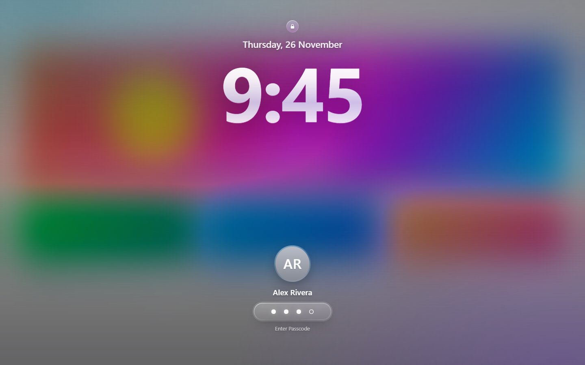
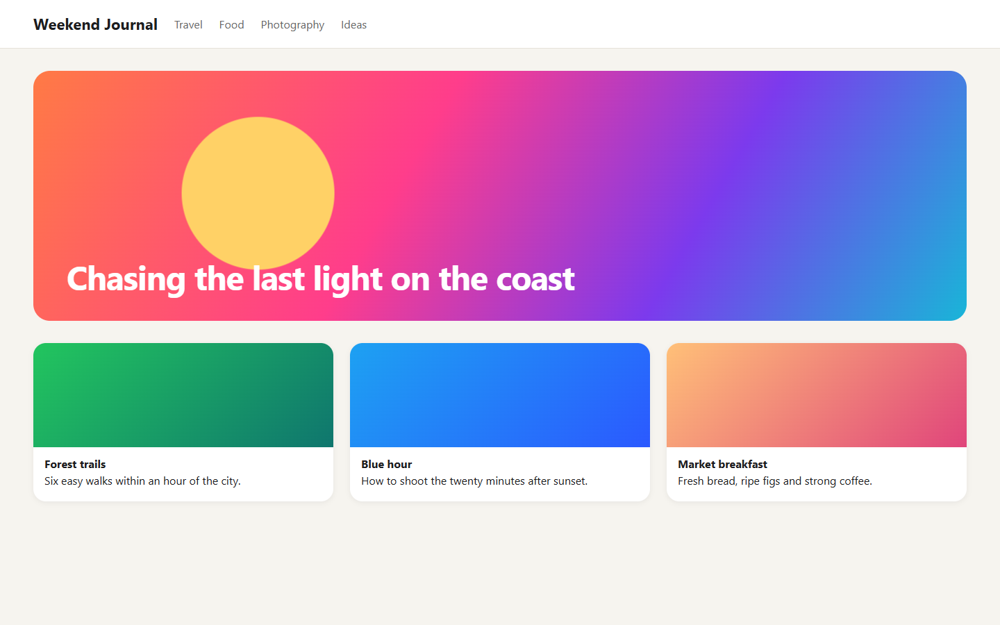
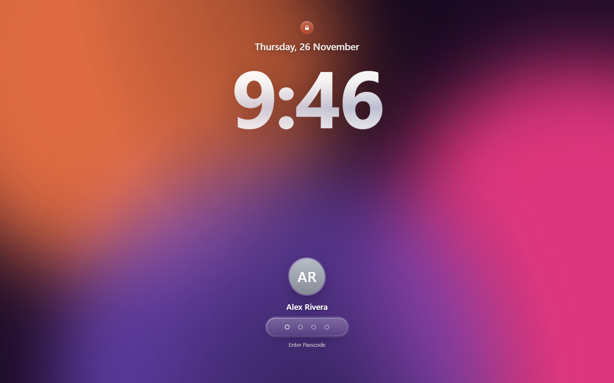
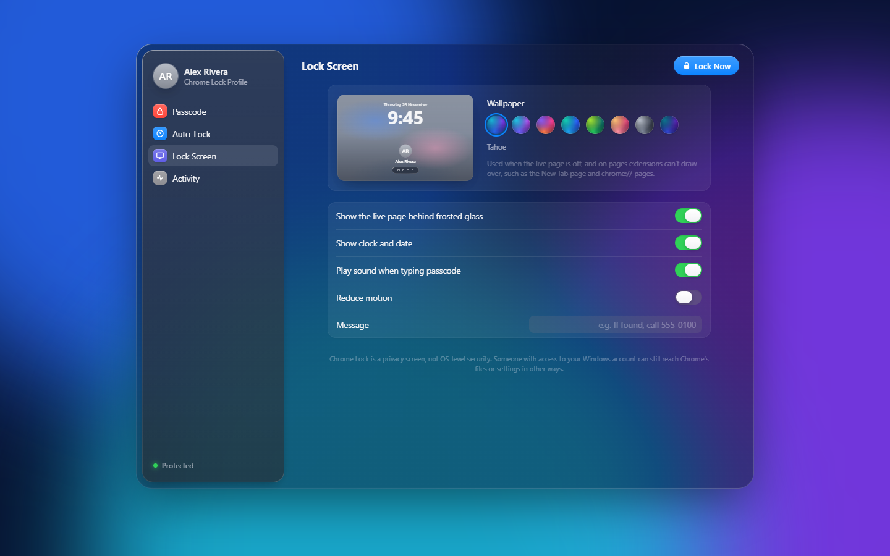
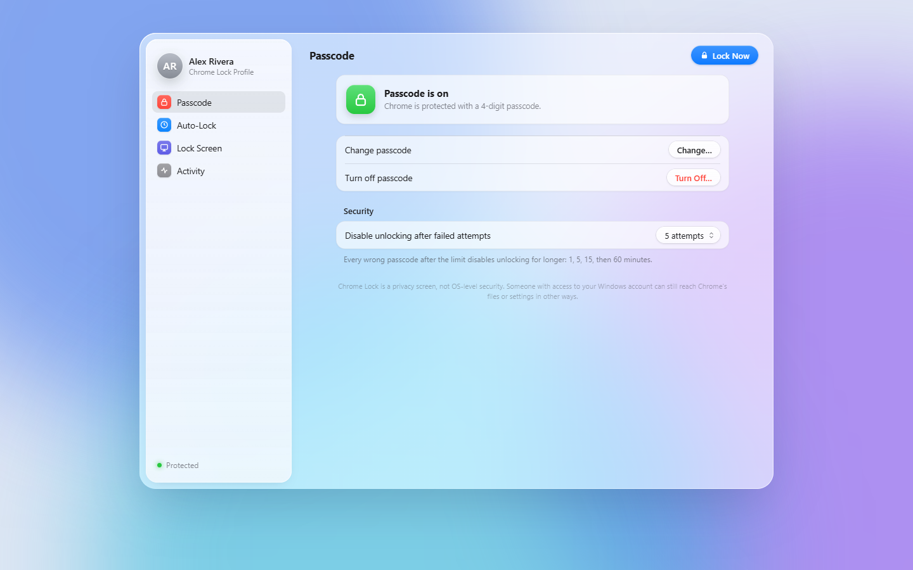
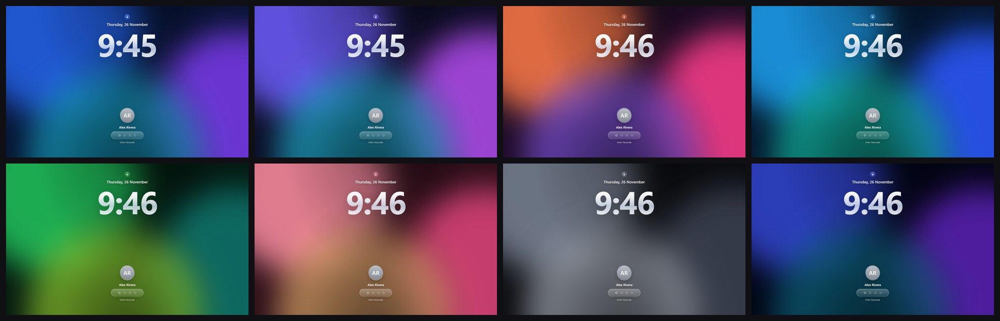

# 🔐 Chrome Lock

Lock **all of Chrome** behind a macOS-style Liquid Glass lock screen drawn right over your window. The page you were on keeps running underneath, heavily blurred behind frosted glass; every other Chrome window is minimized, tab titles are masked, and pages extensions can't draw over (New Tab, `chrome://`) are swapped for a full-page lock until you enter your passcode.

[](https://opensource.org/licenses/MIT)
[](https://developer.chrome.com/docs/extensions/mv3/)



## Screenshots

| | |
|---|---|
|  |  |
| **Before.** An ordinary page. | **Locked, live glass.** The same page keeps running under frosted glass; the dots fill as you type. |
|  |  |
| **Live wallpaper.** With the live page turned off, the gradient drifts slowly (sped up here). | **Wallpaper mode.** Also used on New Tab and `chrome://` pages. Shown: Sunset. |
|  |  |
| **Settings, dark.** Wallpaper picker with a live preview. | **Settings, light.** Passcode and failed-attempt protection. |

All eight wallpapers: Tahoe, Aurora, Sunset, Ocean (top); Forest, Rose Gold, Graphite, Midnight (bottom).



## Features

- 🖥️ **Whole-browser lock** — the glass lock covers every page in place (no separate lock window to close). Closing or minimizing the locked window doesn't get you in: whichever Chrome window you bring up next is already locked.
- 🪟 **macOS Liquid Glass design** — big glass clock and date at the top; your picture and profile name at the bottom, with a glass capsule of 4 or 6 dots (matching your passcode length) that fill as you type.
- 🫧 **Live glass** — the real page stays live under the glass (videos keep moving, counters keep ticking), and sharpens back into focus as you unlock. Turn it off to use an opaque wallpaper instead.
- 🖱️ **One-click lock** — click the toolbar icon to lock immediately; right-click it → **Options** for settings.
- ⌨️ **Keyboard-only entry** — no on-screen keypad. Type the digits; Backspace deletes, Esc clears.
- 👤 **Profile** — set the name and picture shown on the lock screen (Chrome doesn't expose the profile name to extensions, so you enter it once in Settings → Profile).
- 🎨 **Wallpapers** — eight animated gradient themes: Tahoe, Aurora, Sunset, Ocean, Forest, Rose Gold, Graphite and Midnight.
- ⏱️ **Auto-lock** — after idle (1 min – 1 hour), when the computer locks or sleeps, and when Chrome starts.
- 🛡️ **Failed-attempt protection** — after 3, 5 or 10 wrong passcodes, unlocking is disabled for 1 → 5 → 15 → 60 minutes.
- ⌨️ **Keyboard shortcut** — `Alt + Shift + L` locks Chrome instantly (customizable).
- 📜 **Activity log** — see recent locks, unlocks, wrong attempts and lockouts.
- 🔊 **Typing sounds** and ♿ **Reduce Motion** options.
- ⚙️ **System Settings–style options page** — glass sidebar and panes, light and dark mode.

## Installation

1. Open `chrome://extensions/` and enable **Developer mode**.
2. Click **Load unpacked** and select this folder.
3. The Settings page opens automatically — choose a passcode, then add your name under **Profile**.

> Upgrading from v1 (free-text password): your old password is cleared and your auto-lock/startup preferences are kept. Set a new numeric passcode on the Settings page that opens after the update.

## Usage

| Action | How |
| --- | --- |
| Lock now | Click the toolbar icon, press `Alt + Shift + L`, or **Lock Now** in Settings |
| Unlock | Type your passcode on the keyboard |
| Settings | Right-click the toolbar icon → **Options** |
| Change / turn off passcode | Settings → Passcode (requires the current passcode) |

## How it works

1. **Glass lock** — `content.js` adds a closed-shadow-DOM element to every web page, shown as a top-layer popover so it sits above page dialogs. A `backdrop-filter` veil blurs the live page; on top, `lock.html?mode=embed` runs in an extension frame, so the passcode is typed into a document the page can't read. Keys pressed while the page still has focus are swallowed and relayed to that frame. The tab's title and icon are masked while locked.
2. **Window guard** — `background.js` keeps the window you were using visible and minimizes every other Chrome window. Windows restored, created or focused while locked are minimized again; if the locked window is closed or minimized, the next window you bring up becomes the locked one. DevTools windows are closed, and a 30-second `alarms` watchdog re-checks in case an event was missed.
3. **Pages extensions can't draw over** — New Tab, `chrome://` pages, the Web Store, error pages and the like are sent to the full-page lock (`lock.html?mode=tab`), which goes back to the page after unlock. Pages opened before the extension was installed get the content script injected (`scripting`).
4. **Tamper guard** — only the background worker may change the lock state or passcode; a write from anywhere else (e.g. DevTools pointed at the lock frame) is reverted and logged. If something docks into the window while locked (DevTools, a side panel), the tab moves to the full-page lock.
5. **Passcode storage** — PBKDF2-SHA256 (150,000 iterations) with a random per-install salt, stored in `chrome.storage.local`. Settings can't be changed while locked.

## Security notes

Chrome Lock is a **privacy screen**, not OS-level security:

- Anyone who can use your Windows account can still open Chrome's profile folder, or launch Chrome with extensions disabled.
- If the extension isn't allowed in Incognito, Incognito windows aren't covered (enable "Allow in Incognito" on the extension's details page).
- The lock covers the page area. Chrome's own toolbar (tab strip, address bar, bookmarks bar) stays on screen, though tab titles and icons are masked; other Chrome windows are minimized.
- The live page is blurred heavily enough that text can't be read, but colours and layout show through. Turn off **Show the live page behind frosted glass** for an opaque lock.
- A 4–6 digit passcode is easy to brute-force if someone copies the profile's data files. The hash only stops casual inspection.
- To stop people from using DevTools to tamper with the lock, an admin can set the `DeveloperToolsAvailability` Chrome policy.

For real protection, use a separate OS account, full-disk encryption, and lock your computer (`Win + L`) when you walk away.

**Forgot your passcode?** Remove and reinstall the extension (this wipes its data).

## Project structure

```
chrome-profile-lock/
├── manifest.json        # MV3 manifest (permissions: storage, tabs, idle, alarms, scripting, <all_urls>; lock-now command)
├── background.js        # Lock state, window guard, passcode hashing, idle/startup, messaging
├── lock.html/.css/.js   # Lock screen: over the live page (embed) or full page (tab)
├── passcode.js/.css     # Keyboard-driven passcode field (dots in a glass capsule)
├── glass.css            # Shared Liquid Glass material + avatar styles
├── options.html/.css/.js# macOS System Settings–style page
├── content.js           # Glass lock over every web page while locked
├── lock-overlay.css     # Hides page <body> in wallpaper mode
├── themes.js            # Wallpaper palettes + avatar helper
├── wallpaper.css        # Animated gradient wallpaper
└── icons/               # 16/32/48/128 px icons
```

## License

MIT — see [LICENSE](LICENSE).
